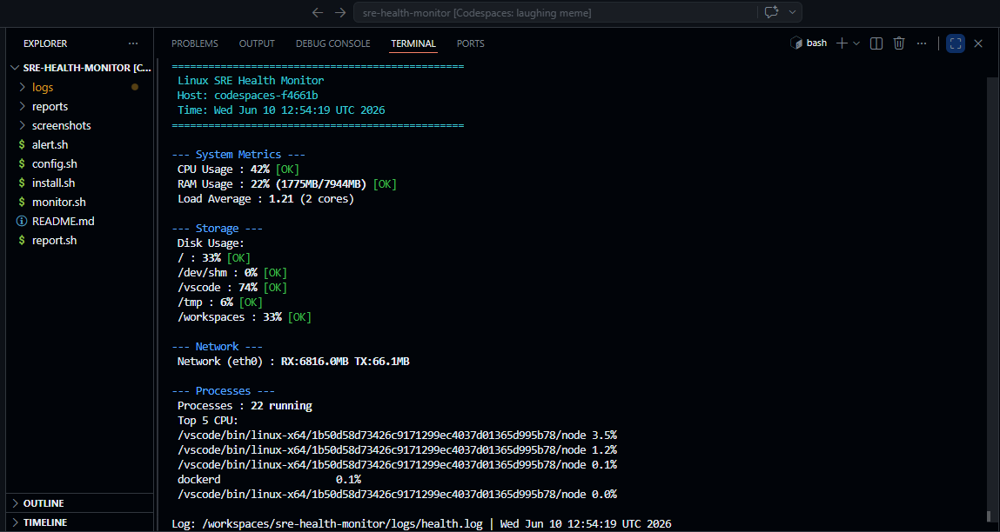
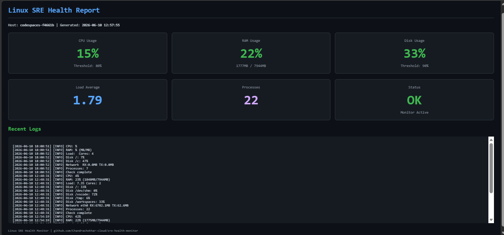
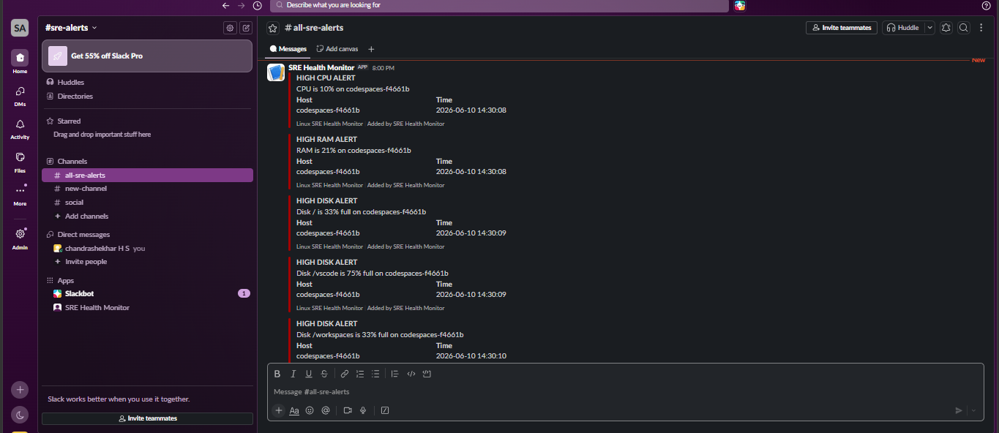
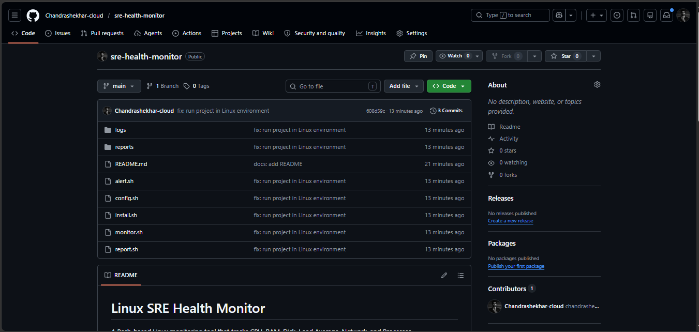

# 🚀 Linux SRE Health Monitor

A modular Linux system health monitoring solution built using **Bash scripting and Linux utilities** to monitor system resources, detect threshold breaches, generate alerts, and produce automated HTML health reports.

The project provides configurable monitoring thresholds, command-line options, dry-run alert simulation, and per-alert cooldown functionality to reduce repetitive notifications.

---

## 📌 Problem Statement

System administrators and Site Reliability Engineers need to continuously monitor system resources to identify performance issues before they affect application availability.

Manually checking CPU utilization, memory consumption, disk usage, network statistics, and running processes can be time-consuming.

This project automates Linux system health monitoring through Bash scripts, providing resource visibility, threshold-based alerts, monitoring logs, and HTML reports.

---

## 🎯 Project Objectives

- Automate Linux system health monitoring.
- Identify CPU, memory, and disk utilization issues.
- Monitor system load, network statistics, and running processes.
- Generate alerts when configured thresholds are exceeded.
- Reduce repetitive notifications using alert cooldown.
- Support safe testing through dry-run execution.
- Generate HTML reports for system health analysis.

---

## ✨ Key Features

### System Monitoring

- CPU utilization monitoring.
- RAM utilization monitoring.
- Disk usage monitoring.
- System load average monitoring.
- Network traffic statistics (RX/TX).
- Running process monitoring.

### Alert Management

- Configurable monitoring thresholds.
- Slack webhook alert integration.
- Dry-run mode for testing alerts without sending messages.
- Per-alert cooldown mechanism.
- Separate cooldown tracking for individual alert types.

### Reporting and Logging

- Automated HTML health report generation.
- Timestamped monitoring logs.
- System resource status reporting.
- Monitoring information through log files.

### Engineering Features

- Modular Bash script architecture.
- Command-line argument support.
- Custom configuration file support.
- ShellCheck static analysis.
- Linux command-line utilities.

---

## 🏗️ System Architecture

    Linux System
         |
         v
      monitor.sh
         |
    +----+----+----+
    |    |    |    |
    v    v    v    v
   CPU  RAM  Disk Load
    |    |    |    |
    +----+----+----+
         |
         v
    Network Statistics
         |
         v
    Process Monitoring
         |
         v
       alert.sh
         |
    +----+----+
    |         |
    v         v
  Dry-Run  Slack Webhook
    |         |
    +----+----+
         |
         v
    Alert Cooldown
         |
         v
      report.sh
         |
         v
    HTML Health Report
         |
         v
      health.log

---

## 📂 Project Structure

    sre-health-monitor/
    │
    ├── config/
    │   └── thresholds.conf.example
    │
    ├── monitor.sh
    ├── alert.sh
    ├── report.sh
    ├── install.sh
    ├── config.sh.example
    │
    ├── logs/
    │   └── health.log
    │
    ├── reports/
    │   └── report_YYYY-MM-DD.html
    │
    ├── screenshots/
    │   ├── monitor-output.png
    │   ├── html-report.png
    │   ├── slack-alert.png
    │   └── github-repo.png
    │
    ├── .gitignore
    └── README.md

**Note:** `config.sh` and `config/thresholds.conf` are local configuration files and should not be committed to Git. Example configuration files provide safe templates.

---

## 🛠️ Technologies Used

| Technology | Purpose |
|---|---|
| Linux (Ubuntu) | Operating system and monitoring environment |
| Bash Scripting | Automation and monitoring logic |
| Linux Utilities | System resource monitoring |
| Cron | Scheduled execution |
| Slack Webhooks | Alert notifications |
| HTML/CSS | Health report generation |
| ShellCheck | Shell script static analysis |
| Git | Version control |
| GitHub | Source code hosting |

---

## ⚙️ Monitoring Configuration

Monitoring thresholds are maintained separately in:

`config/thresholds.conf`

The repository provides a sample configuration:

`config/thresholds.conf.example`

### Default Configuration

| Parameter | Default Value | Description |
|---|---:|---|
| CPU_THRESHOLD | 80% | CPU utilization threshold |
| RAM_THRESHOLD | 85% | Memory utilization threshold |
| DISK_THRESHOLD | 90% | Disk usage threshold |
| LOAD_THRESHOLD | 4 | Configured system load threshold |
| ALERT_COOLDOWN_MINUTES | 30 | Alert cooldown duration |
| SLACK_WEBHOOK_URL | Empty | Optional Slack webhook URL |

The actual configuration file is excluded from version control to prevent accidental exposure of sensitive information.

---

## 🔔 Alert Management

The alert module supports Slack webhook notifications for configured resource threshold breaches.

### 1. Dry-Run Mode

Dry-run mode simulates alert notifications without sending actual Slack messages.

Execute:

    ./monitor.sh --dry-run

Example output:

    [DRY-RUN] Would send alert:

    HIGH DISK ALERT
    Disk /mnt/c is 96% full.

This allows alert behavior to be tested safely without requiring a Slack webhook.

### 2. Alert Cooldown

The project implements a per-alert cooldown mechanism to prevent repeated notifications for the same metric.

Default cooldown:

    30 minutes

Alert state is maintained in:

    /tmp/health_monitor.state

During the cooldown period, repeated alerts for the same metric are suppressed.

Example:

    [COOLDOWN] HIGH DISK ALERT suppressed.
    Try again after cooldown.

Dry-run alert state is maintained separately.

### 3. Slack Webhook Integration

Slack notifications can be enabled by configuring a private webhook URL in the local configuration file.

**Security:** Never commit a real Slack webhook URL to GitHub. Use a private local configuration file.

---

## 🖥️ Command-Line Options

The monitoring script supports the following command-line arguments:

| Command | Description |
|---|---|
| `./monitor.sh` | Run system monitoring |
| `./monitor.sh --help` | Display available options |
| `./monitor.sh --dry-run` | Simulate alert notifications |
| `./monitor.sh --config PATH` | Load a custom configuration file |

### Help Output

    Usage: ./monitor.sh [--dry-run] [--config PATH] [--help]

    --dry-run     Simulate alerts without sending Slack messages
    --config      Specify a configuration file
    --help        Display this help message

### Custom Configuration Example

    ./monitor.sh --config /path/to/thresholds.conf --dry-run

---

## 🚀 Installation and Execution

### Prerequisites

- Linux or Ubuntu environment.
- Bash shell.
- Standard Linux system utilities.
- Git.
- ShellCheck (for static analysis).

### Step 1: Clone the Repository

    git clone https://github.com/Chandrashekhar-cloud/sre-health-monitor.git

    cd sre-health-monitor

### Step 2: Create Local Configuration Files

Copy the sample runtime configuration:

    cp config.sh.example config.sh

Copy the sample monitoring thresholds:

    cp config/thresholds.conf.example config/thresholds.conf

### Step 3: Configure Monitoring Thresholds

Open the configuration file:

    nano config/thresholds.conf

Update the required thresholds.

If Slack notifications are needed, configure your private webhook URL in the local configuration file. Do not commit it.

### Step 4: Make Scripts Executable

    chmod +x *.sh

### Step 5: Run the Monitoring Script

    ./monitor.sh

### Step 6: Generate the HTML Report

    ./report.sh

### Step 7: Test Alert Functionality

    ./monitor.sh --dry-run

---

## 📊 Monitoring Output

The monitoring script displays information about the current system health, including CPU, RAM, disk usage, load average, network traffic, and running processes.

### Example Output

    ================================================
              Linux SRE Health Monitor
    ================================================

    --- System Metrics ---

    CPU Usage       : 4%  [OK]
    RAM Usage       : 59% [OK]
    Load Average    : 1.60

    --- Disk Usage ---

    /               : 1%  [OK]
    /mnt/c          : 96% [CRITICAL]

    --- Network Statistics ---

    Network RX      : 0.0 MB
    Network TX      : 0.0 MB

    --- Process Information ---

    Running Processes: 58

    --- Alert Management ---

    [COOLDOWN] HIGH DISK ALERT suppressed.

    --- Report Generation ---

    HTML report generated successfully.

*Sample values are illustrative and depend on the monitored system.*

---

## 📸 Screenshots

### 1. Terminal Monitoring Output

Displays system resource information, including CPU, RAM, disk usage, load average, network statistics, and running processes.

### 2. HTML Health Report

Displays the generated HTML system health report.

### 3. Slack Alert Notification

Example of Slack notifications generated when configured monitoring thresholds are breached.

### 4. GitHub Repository

Project repository and source code structure.

---

## 🧪 Testing and Validation

The project was validated using the following checks:

| Test | Purpose |
|---|---|
| Bash Syntax Validation | Verify shell script syntax |
| ShellCheck | Identify shell scripting issues |
| Dry-Run Testing | Verify alert behavior without sending Slack messages |
| Custom Configuration Testing | Verify custom threshold loading |
| Cooldown Testing | Verify repeated alert suppression |
| HTML Report Testing | Verify report generation |

### Bash Syntax Validation

    bash -n monitor.sh
    bash -n alert.sh
    bash -n report.sh

### ShellCheck Validation

    shellcheck *.sh

All shell scripts passed ShellCheck validation during project testing.

---

## 💡 Key Engineering Highlights

- Developed a modular Bash-based Linux system health monitoring solution.
- Implemented monitoring for CPU, RAM, disk, load average, network, and running processes.
- Created external configuration files for configurable monitoring thresholds.
- Added command-line options for dry-run execution and custom configuration.
- Implemented per-alert cooldown to reduce repetitive notifications.
- Integrated optional Slack webhook alerting.
- Automated HTML health report generation.
- Used Linux utilities for system monitoring and troubleshooting.
- Validated shell scripts using ShellCheck and functional testing.

---

## 🔮 Future Enhancements

- Docker container monitoring.
- Kubernetes health monitoring.
- Prometheus metrics exporter.
- Grafana dashboard integration.
- Multi-server monitoring.
- Historical performance analysis.
- Centralized monitoring and alert management.

---

## 👨‍💻 Author

**Chandrashekhar H S**

Computer Science and Engineering

GitHub: https://github.com/Chandrashekhar-cloud

---

⭐ If you find this project useful, consider giving it a star!
